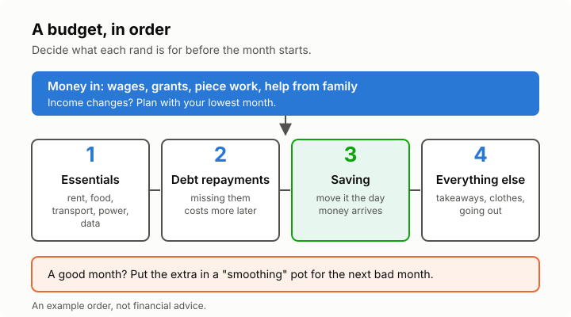

# Lesson 1: Making a budget that works
<!-- facts: none -->

## By the end, the learner can

- Write down what money comes in and goes out in a month, even if their income changes.
- Sort spending into essentials, debt repayments, saving and everything else.
- Plan a month on a low or irregular income by budgeting from their lowest likely month.
- Track spending for a week and spot where money leaks away.

## Key ideas

**A budget is a plan, not a punishment.** It is simply deciding, before the month starts, what
each rand is for. Without a plan, money tends to disappear on small things.

**Money in.** Count everything: wages, piece work, grants, money from family, side hustles. If it
changes from month to month, look back over a few months and plan with the *lowest* one. A good
month then becomes extra, not a surprise you have already spent.

**Money out, in order.**
1. **Essentials:** rent, food, transport, electricity, water, airtime and data you need for work
   or school.
2. **Debt repayments:** missing these costs more later (lessons 3 to 6).
3. **Saving:** even a small amount, every time money comes in (lesson 7).
4. **Everything else:** takeaways, clothes, going out, gifts.

**Pay yourself first.** If you only save what's left at the end of the month, there is usually
nothing left. Move your saving amount the day money arrives.

**Watch the leaks.** Bank fees, airtime bought in small bundles, impulse buys and "just R20" add
up. Writing down every spend for one week is the quickest way to find them.

**Irregular income.** Freelancers, taxi drivers, domestic and seasonal workers often get paid
unevenly. Keep a separate "smoothing" pot: in good months, top it up; in bad months, pay yourself
a steady amount from it.

**Black tax and family support.** Many people support relatives. Put it in the budget as its own
line, so it is planned rather than a surprise, and so you can talk about what you can afford.

## Worked example

Lerato does piece work. Her income over three months was R5 200, R6 800 and R4 600, so she plans
on R4 600. Rent R1 800, food R1 300, transport R700, electricity and data R400 come to R4 200.
That leaves R400: R150 to her store account repayment, R150 to saving, R100 for everything else.
In a R6 800 month, the extra R2 200 goes into her smoothing pot, not into spending.

## Exercise

Ask the learner to list their own money-in sources and their four biggest essential costs, in
round numbers they are comfortable sharing (or made-up ones). Then ask: what is the lowest
month's income you should plan around, and what would you cut first if that month came?

## Sources

- [NCR consumer tips](https://www.ncr.org.za/index.php/departments/education-and-communications/15-education-and-communications/37-consumer-tips)
- [FSCA consumer education](https://www.fscamymoney.co.za/)
