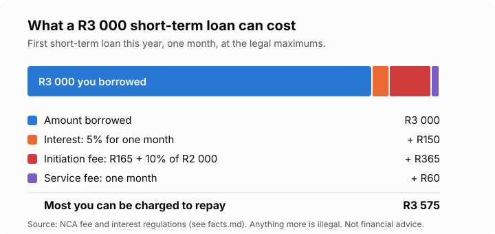

# Lesson 3: How credit works, and what it costs
<!-- facts: Repo rate; Maximum interest rates; Maximum initiation and service fees; Reckless lending -->

## By the end, the learner can

- Name the common kinds of credit: store cards, credit cards, overdrafts, personal loans, home
  and car finance.
- Explain interest, initiation fees, service fees and credit life insurance.
- Say what the National Credit Act and the NCR do, and that the Act caps interest and fees.
- Work out the total cost of a small loan, and compare it to the amount borrowed.
- Explain what reckless lending is.

## Key ideas

**Credit is borrowing future income.** Every rand you repay next month is a rand you can't spend
on something else then. Credit can help (a home loan, a fridge that saves on spoiled food) or
trap you (buying clothes on a store card at high interest).

**The National Credit Act (NCA)** protects people who borrow. The **National Credit Regulator
(NCR)** registers lenders, credit bureaus and debt counsellors, and enforces the Act.

**The cost of credit has parts.**
- **Interest:** a percentage of what you owe, charged over time.
- **Initiation fee:** a once-off fee for opening the agreement.
- **Monthly service fee:** charged every month the agreement runs.
- **Credit life insurance:** pays the debt if you die or can't work; often added to loans, so
  check whether it's included and what it costs.

Interest and fees have legal maximums (`facts.md`). Interest limits are linked to the Reserve
Bank's **repo rate**, so they move when it moves.

**Read the quote.** Before you sign, ask for the quote in writing, showing the instalment, the
total you'll repay and every fee. Compare the *total repaid*, not just the monthly instalment:
a longer loan has a smaller instalment but costs far more.

**Reckless lending.** A lender must check that you can afford a loan before giving it. Lending
without that check, or when the check shows you can't afford it, can be reckless credit, and a
court can set the agreement aside (`facts.md`). Answer the affordability questions honestly.

## Worked example

Thabo borrows R3 000 for one month, his first short-term loan this year. Using the limits in
`facts.md`: interest at 5% a month is R150; the initiation fee is R165 + 10% of R2 000 = R365;
the service fee is R60. He could repay up to **R3 575**: R575 for one month of borrowing. A lender
charging more than this is breaking the law.

## Exercise

Ask the learner to work out the most a lender may charge on a first short-term loan of R1 500
for one month, using `facts.md`. Then ask: why does a lower instalment over a longer time often
cost more in total?

## Sources

- [National Credit Act 34 of 2005](https://www.gov.za/documents/national-credit-act)
- [Limitations of fees and interest rates regulations](https://www.gov.za/sites/default/files/gcis_document/201511/39379gon1080.pdf)
- [SARB monetary policy statements](https://www.resbank.co.za/en/home/publications/publication-detail-pages/statements/monetary-policy-statements/2026/september)
