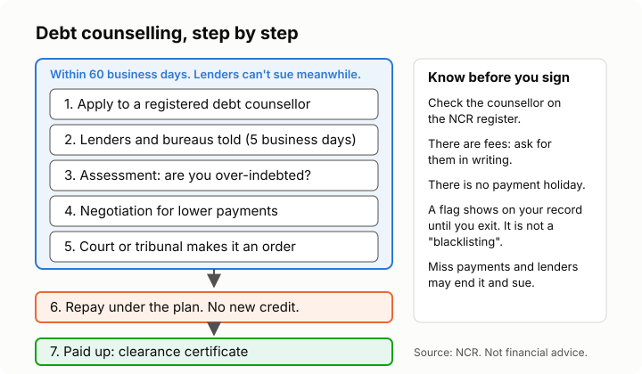

# Lesson 6: When debt gets too much
<!-- facts: Debt counselling; Limits on what you can owe after default; Reckless lending; Where to get help -->

## By the end, the learner can

- Recognise the signs of being over-indebted.
- List their debts and choose which to deal with first.
- Explain debt counselling (debt review): how it works, what it costs, and its downsides.
- Name the legal protections they have: the in duplum rule, notice before legal action,
  prescription and reckless lending.
- Spot fake "debt relief" offers.

## Key ideas

**Signs of trouble.** Borrowing to repay other loans, missing payments, juggling which account to
skip this month, debit orders bouncing, avoiding calls from lenders. Most people in debt trouble
didn't get there by being careless; a lost job, illness or a death in the family is often enough.

**Step 1: see it all.** List every debt: who it's to, what's owed, the monthly payment and the
interest rate. Seeing it on one page is hard, but it's where control starts.

**Step 2: talk to your lenders early.** Before you miss a payment, ask for a payment arrangement.
Lenders often agree to lower instalments for a while; get it in writing.

**Step 3: priorities.** Many people put a roof over their head, essentials and anything secured
(a car or house that can be repossessed) first, then the debts with the highest interest.

**Debt counselling (debt review)** is the legal process for people who can't keep up. An
NCR-registered debt counsellor checks if you're over-indebted, negotiates lower payments with
your lenders, and has the plan made a court or tribunal order. While it's being set up, lenders
can't take legal action. But: you can't take new credit until you exit, there are fees, and you
must keep paying. Time limits and rules are in `facts.md`.

**Protections in the law** (`facts.md`):
- **In duplum:** once you default, interest and charges can't grow past the unpaid balance.
- **Notice first:** a lender must write to you before suing.
- **Reckless lending:** if a lender didn't check affordability, a court can set the agreement
  aside. A debt counsellor can look into this.
- **Prescription:** most ordinary debts can no longer be enforced after a set time, unless the
  clock was interrupted.

**Beware fake help.** Only NCR-registered debt counsellors may do debt review; check the register
in `facts.md`. Be wary of anyone who asks for a big upfront payment, promises to "wipe" your debt
or "remove you from the blacklist", or tells you to stop paying without a plan.

## Worked example

Pieter owes on a personal loan, two store cards and a cellphone contract, and his instalments are
more than half his pay. He lists them, phones each lender, and two agree to lower payments. When
the third sends him a letter about legal action, he checks the NCR register, finds a debt
counsellor, and asks for the fees in writing before he signs anything.

## Exercise

Ask the learner to rank a made-up list of debts (rent arrears, a car instalment, a store card at
21%, a personal loan at 28%) in the order they'd deal with them, and explain why. Then ask: what
are two downsides of debt review?

## Sources

- [NCR: debt counselling](https://www.ncr.org.za/index.php/departments/debt-counselling)
- [NCR register of debt counsellors](http://www.ncr.org.za/register_of_registrants/registered_dc.php)
- [National Credit Act 34 of 2005](https://www.gov.za/documents/national-credit-act)
- [Prescription Act 68 of 1969](https://www.gov.za/sites/default/files/gcis_document/201505/act-68-1969.pdf)
