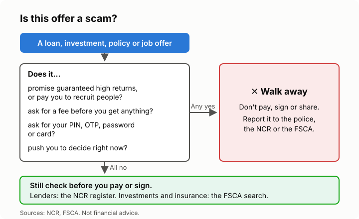

# Lesson 8: Insurance, funeral policies and scams
<!-- facts: Life and funeral insurance rights; Pyramid schemes; Where to get help -->

## By the end, the learner can

- Explain what insurance is for, and the difference between life, funeral and short-term cover.
- Read the key parts of a funeral policy: who is covered, waiting period, exclusions, and what
  happens if a premium is missed.
- Use their cooling-off right, and check that a seller is licensed.
- Spot common money scams, and say where to report them.

## Key ideas

**Insurance moves a big risk to an insurer** for a regular premium. *Life* cover pays out when
someone dies; *funeral* cover is a smaller life policy for funeral costs; *short-term* insurance
covers things like cars, homes and phones. Insure what you couldn't afford to replace or pay for.

**Funeral policies** are sold everywhere, from shops to door-to-door agents, so read them
carefully. Before signing, check:
- **Who is covered,** and up to what age.
- **The waiting period:** a time after you join when some deaths aren't covered. Ask how long.
- **Exclusions** and what counts as a valid claim.
- **What happens if you miss a premium:** there is a grace period before it lapses (`facts.md`).
- **Whether you already have cover** elsewhere, for example through work or a burial society.

Several small policies on the same person can cost more than one adequate one.

**Your rights** (`facts.md`): you can cancel a new life or funeral policy within the cooling-off
period if you haven't claimed. Whoever sells you a policy must be an FSCA-authorised financial
services provider; check on the FSCA's search. Complaints go to the insurer first, then the
NFO, or the FAIS Ombud if it's about the person who sold or advised you.

**Common money scams:**
- **"Guaranteed" high returns,** forex or crypto "trading", or schemes that pay you to recruit.
  Pyramid and multiplication schemes are illegal, and so is knowingly joining one (`facts.md`).
- **Fake loans** that ask for an upfront "admin" or "insurance" fee before paying out.
- **Phishing:** messages or calls asking for your PIN, OTP, password or card details. Never
  share them with anyone, whoever they say they are; hang up and phone your bank yourself.
- **Fake job offers** that ask you to pay for training or uniforms, or to receive money into your
  account for someone else (a "money mule": you are helping move stolen money).

**Report it.** Scams and threats go to the police. Unlicensed investment or insurance sellers go
to the FSCA, and illegal lenders to the NCR (`facts.md`). Tell your bank at once if you shared a
PIN or OTP.

## Worked example

A WhatsApp message offers Busi a R10 000 loan "with no credit check" if she first pays a R499
"insurance fee". Using the scam check: a fee before the loan is paid out is a classic sign. She
searches for the lender on the NCR register and doesn't find it, so she blocks the number.

## Exercise

Make up two offers for the learner, clearly labelled as examples: a funeral policy with a
six-month waiting period, and a "stokvel" promising 30% a month. Ask what questions they'd ask
about the first, and why the second is a red flag.

## Sources

- [FSCA: Life (long-term) insurance consumer guide](https://www.fscamymoney.co.za/Publications/Life%20(Long-term)%20Insurance%202021.pdf)
- [FSCA FSP search](https://www.fsca.co.za/FSB-Search/)
- [National Financial Ombud Scheme](https://nfosa.co.za/)
- [FAIS Ombud](https://www.faisombud.co.za/)
- [Consumer Protection Act 68 of 2008](https://www.gov.za/documents/consumer-protection-act)
